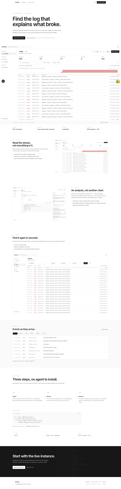
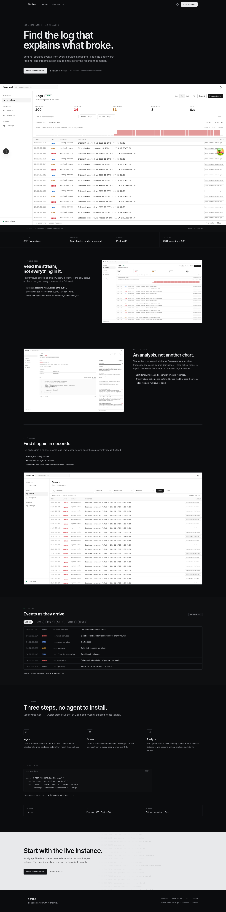
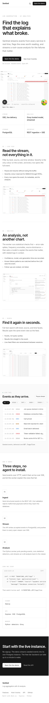

# Sentinel

> Log aggregation with AI-powered root-cause analysis

[](https://www.typescriptlang.org/)
[](https://www.python.org/)
[](https://nextjs.org/)
[](https://www.postgresql.org/)
[](LICENSE)

Sentinel ingests logs over HTTP, streams them to every open browser over SSE, and lets a Python worker explain the failures that matter. Instead of another wall of rows, you get a severity-coloured live feed, full-text search, frequency analysis, and a written root cause for the events worth reading.



| Dark theme | Mobile |
|:----------:|:------:|
| [](screenshots/landing/1440-dark.png) | [](screenshots/landing/390-light.png) |

## Table of contents

- [Why Sentinel](#why-sentinel)
- [Architecture](#architecture)
- [Quick start](#quick-start)
- [Configuration](#configuration)
- [API reference](#api-reference)
- [Project structure](#project-structure)
- [How analysis works](#how-analysis-works)
- [Development](#development)
- [Deployment](#deployment)
- [License](#license)

## Why Sentinel

Log tools usually give you grep with a nicer font. Sentinel separates the two jobs that matter:

- **Read the stream, not everything in it.** Severity is the only colour you need; warnings and above carry a short root-cause line, drawn from the analysis attached to that event.
- **An analysis, not another chart.** Error-rate spikes, frequency anomalies, and source dominance are computed first, then a model explains the event that matters with the related logs in context.
- **Find it again in seconds.** Facets, not query syntax — search by level, source, and time, then open the same event as a full record with its raw log and analysis.

The result is a dashboard you can leave open on a second monitor, a marketing page at `/` that explains the thing in one screen, and an API simple enough to instrument a service in a single line:

```bash
curl -X POST "$SENTINEL_API/logs" \
  -H "Content-Type: application/json" \
  -d '{"level":"ERROR","source":"payment-service","message":"Database connection failed"}'
```

## Architecture

```
┌───────────────┐      ingest / query      ┌───────────────┐
│    Viewer     │ ───────────────────────▶ │      API      │
│  Next.js 16   │ ◀─── SSE live stream ─── │   Express 4   │
└───────────────┘                          └───────┬───────┘
        ▲                                          │
        │  analyses                                ▼
┌───────┴───────┐        pending logs      ┌───────────────┐
│  AI Worker    │ ◀─────────────────────── │  PostgreSQL   │
│ FastAPI + LLM │ ──────── analyses ─────▶ │  (Drizzle)    │
└───────┬───────┘                          └───────────────┘
        │
        ▼
   Groq API (llama-3.1-8b-instant)
```

- **API** (`api/`) — TypeScript and Express. Validates payloads with Zod, persists to PostgreSQL through Drizzle, keeps a hot in-memory buffer for fast reads, and fans events out over SSE.
- **Worker** (`worker/`) — Python and FastAPI. Polls for unanalysed logs on a schedule, runs statistical detectors, then asks Groq for a structured explanation.
- **Viewer** (`viewer/`) — Next.js 16 and React 19. A marketing route group at `/` and the dashboard route group under `/dashboard`, sharing one design system and theme.

## Quick start

### Prerequisites

- Node.js 18+ and npm
- Python 3.11+ and pip
- PostgreSQL 15+ running locally (TimescaleDB optional)
- A Groq API key for AI analysis — [console.groq.com](https://console.groq.com)

### 1. Install

```bash
git clone git@github.com:shreyanshxyz/sentinel.git
cd sentinel

cd api && npm install && cd ..
cd viewer && npm install && cd ..
cd worker && python -m venv venv && ./venv/bin/pip install -r requirements.txt && cd ..
```

### 2. Configure

```bash
cp api/.env.example api/.env
cp worker/.env.example worker/.env
```

Set the database credentials in `api/.env` and `GROQ_API_KEY` in `worker/.env`.

### 3. Run everything

```bash
./project-run.sh
```

That starts the API on `:8000`, the viewer on `:3000`, the worker HTTP API on `:8080`, and the analysis scheduler, seeds sample logs, then posts more every minute. Ctrl+C stops all of it.

| Command | Effect |
| ------- | ------ |
| `./project-run.sh` | start, then follow logs |
| `./project-run.sh status` | show what is still running |
| `./project-run.sh logs` | follow logs without stopping services |
| `./project-run.sh restart` | stop, then start |
| `./project-run.sh stop` | stop everything started by the script |

Open:

- `http://localhost:3000` — marketing page
- `http://localhost:3000/dashboard` — live feed, search, analytics, settings
- `http://localhost:8000/api/logs` — raw API

> 💡 **Live demo**: [sentinel-one-beta.vercel.app](https://sentinel-one-beta.vercel.app). The backend runs on Render's free tier and can take 30–60 seconds to wake from a cold start.

## Configuration

### API

| Variable | Default | Description |
| -------- | ------- | ----------- |
| `PORT` | `8000` | HTTP port |
| `HOST` | `0.0.0.0` | Bind address |
| `NODE_ENV` | `development` | Runtime environment |
| `CORS_ORIGINS` | — | Comma-separated allowed origins |
| `DATABASE_HOST` | `localhost` | PostgreSQL host |
| `DATABASE_PORT` | `5432` | PostgreSQL port |
| `DATABASE_NAME` | `sentinel` | Database name |
| `DATABASE_USER` | `sentinel` | Database user |
| `DATABASE_PASSWORD` | `sentinel_password` | Database password |
| `DATABASE_SSL` | `false` | Require TLS to PostgreSQL |
| `DATABASE_MAX_CONNECTIONS` | `20` | Pool size |
| `MAX_LOGS_IN_MEMORY` | `10000` | Hot in-memory buffer size |
| `DEFAULT_PAGE_SIZE` | `20` | Default page size |
| `MAX_PAGE_SIZE` | `100` | Hard page-size cap |
| `SSE_HEARTBEAT_INTERVAL_MS` | `30000` | Keep-alive ping interval |
| `MAX_REQUEST_SIZE` | `10mb` | Largest accepted body |
| `RATE_LIMIT_WINDOW_MS` | `60000` | Rate-limit window |
| `RATE_LIMIT_MAX` | `100` | Requests per window |
| `LOG_RETENTION_DAYS` | `30` | Retention window |
| `LOG_COMPRESSION_DAYS` | `7` | Compaction threshold |
| `DEMO_SEED` | `false` | Stream seeded demo events |
| `DEMO_SEED_INTERVAL_MS` | `60000` | Delay between demo seeds |

### Worker

| Variable | Default | Description |
| -------- | ------- | ----------- |
| `API_BASE_URL` | `http://localhost:8000` | API endpoint |
| `WORKER_PORT` | `8080` | Worker HTTP port |
| `GROQ_API_KEY` | — | Groq key (required for LLM analysis) |
| `GROQ_MODEL` | `llama-3.1-8b-instant` | Model used for explanations |
| `USE_GROQ` | `true` | Use Groq instead of local Ollama |
| `ANALYSIS_INTERVAL` | `60` | Seconds between analysis runs |
| `BATCH_SIZE` | `50` | Logs per batch |
| `ERROR_RATE_THRESHOLD` | `0.1` | Anomaly trigger threshold |

## API reference

### Ingest a log

```bash
POST /api/logs
Content-Type: application/json

{
  "message": "Database connection failed",
  "level": "ERROR",
  "source": "payment-service",
  "labels": { "environment": "production", "region": "us-east-1" }
}
```

### Query and stream

```bash
GET  /api/logs?level=ERROR&source=payment-service&limit=50
GET  /api/logs/live              # SSE, text/event-stream
GET  /api/logs/:id
```

### Analytics

```bash
GET /api/health
GET /api/sources
GET /api/analytics
GET /api/analytics/hourly
GET /api/analytics/timeseries
```

### Analysis

```bash
GET  /api/logs/analysis/pending
GET  /api/logs/analysis/stats
GET  /api/logs/analysis/critical
GET  /api/logs/:id/analysis
GET  /api/logs/:id/analyze-stream   # SSE, token by token
POST /api/logs/:id/analyze
POST /api/logs/analysis             # store a worker result
```

## Project structure

```
sentinel/
├── api/                        # Express ingestion and query API
│   └── src/
│       ├── controllers/        # Request handlers
│       ├── db/                 # Drizzle schema, migrations, repositories
│       ├── middleware/         # Rate limit, logging, errors
│       ├── routes/             # Route definitions
│       ├── services/           # Log, stream, AI, demo seeder
│       └── validation/         # Zod schemas
├── worker/                     # Python analysis worker
│   └── src/
│       ├── services/           # Detectors, LLM client, prompts
│       └── models/             # Pydantic models
├── viewer/                     # Next.js front end
│   ├── app/
│   │   ├── (marketing)/        # Landing page at /
│   │   └── (app)/dashboard/    # Feed, search, analytics, settings
│   ├── components/
│   │   ├── marketing/          # Hero, features, live tail, CTA
│   │   ├── layout/             # Nav rail, top bar
│   │   └── ui/                 # Buttons, icons, theme toggle
│   └── public/product/         # Product screenshots used on the page
├── screenshots/                # README screenshots
├── project-run.sh              # One command for local development
└── render.yaml                 # Deployment blueprint
```

## How analysis works

1. **Ingest** — logs are validated with Zod and written to PostgreSQL, with a copy in the in-memory buffer.
2. **Stream** — the API pushes each accepted log to every connected SSE client.
3. **Detect** — the worker groups pending logs and runs statistical checks: error-rate spikes, frequency anomalies (2× baseline), and source dominance (>80% from one source).
4. **Rank** — high-severity logs and detected anomalies are prioritised; known error signatures are matched by regex.
5. **Explain** — an LLM prompt is built from the event plus related logs, streamed from Groq, and parsed into structured analysis: severity, root cause, and follow-up actions.
6. **Show** — the analysis is stored back on the log, so the feed, the detail view, and the search results all read the same explanation.

## Development

```bash
# API
cd api
npm run dev          # tsx watch
npm run typecheck    # tsc --noEmit
npm run build        # tsc to dist/
npm run db:push      # apply Drizzle schema
npm run db:studio    # browse data

# Viewer
cd viewer
npm run dev          # Next.js dev server
npm run lint         # ESLint
npm run build        # production build

# Worker
cd worker
python -m src.main                 # run the worker
LOG_LEVEL=DEBUG python -m src.main # verbose logging
```

The viewer is a static-rendered marketing page plus client dashboards. Motion is limited to one hero entrance and one live stream, and collapses under `prefers-reduced-motion`.

## Deployment

- **Viewer** — deploy `viewer/` to Vercel. Statically prerendered marketing page, dynamic dashboard routes.
- **API** — deploy `api/` to Render (see `render.yaml`), Railway, or any Node host. Needs PostgreSQL and `CORS_ORIGINS` set to the viewer origin.
- **Worker** — deploy `worker/` to any Python host. Needs `GROQ_API_KEY` and `API_BASE_URL`.

Required production variables:

- `GROQ_API_KEY` — [console.groq.com](https://console.groq.com)
- `DATABASE_*` — PostgreSQL connection
- `CORS_ORIGINS` — the deployed viewer origin
- `NEXT_PUBLIC_API_URL` — the deployed API origin, read by the viewer

## License

MIT — see [LICENSE](LICENSE).
